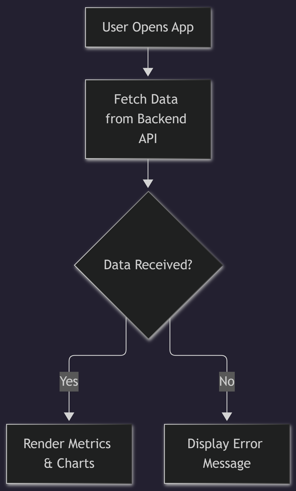

# Plant Monitoring Dashboard

This is the frontend dashboard for the plant monitoring system, built with React, TypeScript, and Vite.

## Application Flow

## Setup
1.  Install dependencies: `npm install`
2.  Set up environment variables in `.env`.
3.  Run the development server: `npm run dev`
4.  Build for production: `npm run build`

